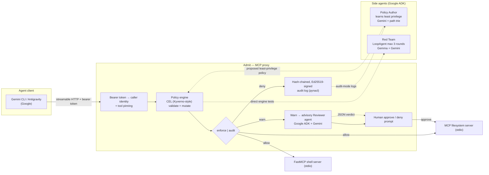

# Admit

Least-privilege policies for coding agents that harden themselves. Admit learns a minimal policy
from what your agent actually does, its own red-team agent attacks the policy and patches the
gaps, and you approve every change. Enforcement is a deterministic, fail-closed MCP gateway: every
tool call must pass Kyverno-style CEL policies before it runs.

Coding agents read files and run commands on your machine, and anything they read can steer them.
On most developers' laptops nothing checks an agent's actions before they happen, and hand-written
blocklists miss bypasses. Admit sits in the path of every tool call; the security path is
deterministic and makes zero model calls, so enforcement never depends on a model's judgement.

## Quickstart

Requires [uv](https://docs.astral.sh/uv/) and Node (for the `npx` filesystem server).

**Windows (PowerShell)**

```powershell
uv sync
Copy-Item .env.example .env   # then fill in GOOGLE_API_KEY
uv run admit serve --policies policies/baseline.yaml
# in a second terminal, inside the demo repo:
cd demo-repo; gemini
```

**macOS / Linux**

```bash
uv sync
cp .env.example .env          # then fill in GOOGLE_API_KEY
uv run admit serve --policies policies/baseline.yaml
# in a second terminal, inside the demo repo:
cd demo-repo && gemini
```

One-shot demo of the whole flow (policy deny, warn + human prompt, verify audit log):

```bash
uv run admit demo
```

## Architecture



Google components: Gemini CLI / Antigravity (client), Google ADK (agent framework), Gemini and Gemma
(models for the side agents), CEL (policy language). Enforcement itself is pure code — no model in the
security path.

## Agentic Capability & Innovation

- TODO(verify): Policy Author agent learns a least-privilege policy from audit-mode logs, not from a prompt.
- TODO(verify): Path trie compresses observed file access into readable, minimal policy rules.
- TODO(verify): Red Team agent proposes bypasses, then tests them directly against the policy engine.
- TODO(verify): Red Team loop is bounded (ADK `LoopAgent`, max 3 rounds) and reports what survived.
- TODO(verify): Every run emits concrete artifacts: policy YAML, bypass report, audit log.

## Security & Trust

- TODO(verify): Every call is identified by bearer token → caller identity; tools are pinned per caller.
- TODO(verify): CEL policies validate and mutate arguments before the downstream server sees them.
- TODO(verify): `enforce` vs `audit` mode — same decision, one blocks, one only records.
- TODO(verify): `Warn` decisions go to an advisory Reviewer agent and then a human prompt; the human decides.
- TODO(verify): Audit log is hash-chained and Ed25519-signed; `admit verify` detects any tampering.
- TODO(verify): The enforcement path makes zero model calls — no prompt injection surface in the decision.

## Scalability & Technical Execution

- TODO(verify): MCP streamable HTTP in, MCP stdio out — standard MCP, no agent-side patching beyond config.
- TODO(verify): Pluggable downstream servers: `npx` filesystem server plus a small FastMCP shell server.
- TODO(verify): Policy evaluation is local CEL, sub-millisecond and stateless — scales with the proxy.
- TODO(verify): `admit posture` summarises current exposure (callers, tools, modes, policy coverage).
- TODO(verify): Cross-platform: CI runs the suite on Ubuntu, Windows, and macOS.
- TODO(verify): ADK agents are optional side channels; Admit still runs with models disabled.

## Limitations

- Admit governs **which** actions run, not what an allowed program does internally. If
  `python -m pytest` is allowed, a malicious test file can still open a network connection. Run
  agents in a no-network sandbox alongside Admit; the two are complementary.
- Harness built-in tools must be disabled or routed through the fail-closed `admit hook`: Admit
  only governs calls that reach it, so a native shell or file tool outside both paths bypasses
  policy entirely.
- TODO(verify): hook behaviour on timeout and on a hook command that fails to start depends on
  the harness; tested results go here.
- Prototype key handling: the Ed25519 signing key and caller secrets live on local disk / `.env`;
  production needs a KMS, rotation, and per-caller provisioning.
- Transactional sagas are not built: a mutated call that fails downstream is not rolled back, and
  there is no compensation or two-phase approval across multiple tool calls.

## Built with

Google ADK · Gemini · Gemma · CEL (Kyverno-style) · Gemini CLI · FastMCP · MCP filesystem server ·
pynacl — Claude: used as coding assistant.

## Contributing

See [CONTRIBUTING.md](CONTRIBUTING.md).
